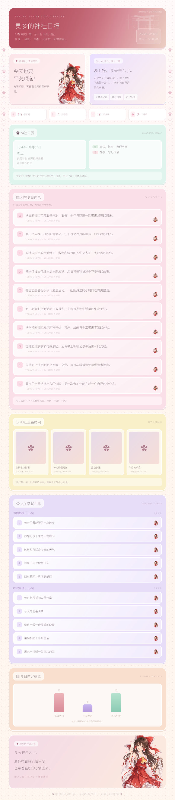

# 博丽灵梦 · 神社日报主题 v2.2.1

新增 `reimu` 主题，参考浅色卡片长日报布局：顶部横幅、灵梦欢迎卡、日历黄历、新闻列表、番剧封面、各站热榜、实际条目数量概览和底部人物。

上传 ZIP 并重载插件，在配置中选择 `report_theme = reimu`，标题改为「灵梦的神社日报」，推荐 `render_scale = 2.0`。已有配置不会被默认值覆盖，请手动选择主题与标题。

人物插画随插件打包，运行时转换为 Data URI；主题不依赖远程字体、图片或脚本。番剧封面沿用原插件的下载并内嵌逻辑。模板位于 `templates/reimu.html`，文字为动态 HTML，页面高度随内容增加。预览是模拟数据；不含群聊记录分析、活跃度或 AI 群聊总结。内容概览与顶部计数均统计本页实际展示的条目：开启封面时按已展示的番剧卡片数量计数，关闭封面时按番名列表计数；获取失败的板块计为 0。各站热榜的数量是所有成功展示的榜单条目之和。

人物素材使用内置图像生成制作，核心提示词：博丽灵梦、红白巫女服、大红蝴蝶结、手持符纸与御币、温柔微笑、樱花花瓣、日系动画插画、透明背景、无文字水印。

保留 `chino`、`night`、`murasame`、`plain` 和 `auto` 主题，以及原有指令、API 配置和定时推送。`auto` 仍为白天智乃、夜间星夜。

---

# astrbot_plugin_dailyreport · 每日日报

聚合 **每日新闻、今日番剧、各站热榜、日历/农历黄历** 的 AstrBot 日报插件。可用指令随时查看，也可定时推送到指定群/私聊，并提供 LLM 函数工具让人格 AI 主动调用。

## 安装

1. 把 `astrbot_plugin_dailyreport` 文件夹放进 AstrBot 的 `data/plugins/`（或在 WebUI「插件」里上传 zip）。
2. 插件管理处「重载插件」。
3. 依赖 `aiohttp`、`apscheduler`、`cnlunar`。AstrBot 一般会自动按 `requirements.txt` 安装；若农历不显示或定时不生效，多半是 `cnlunar` / `apscheduler` 没装上，可在 WebUI「平台日志 → 安装 Pip 库」手动装。

## 指令

| 指令 | 作用 | 别名 |
| --- | --- | --- |
| `/日报` | 输出完整日报（日历+新闻+番剧+热榜） | `dailyreport`、`今日日报` |
| `/每日新闻` | 只看今日新闻（60 秒） | `今日新闻`、`60秒` |
| `/今日番剧` | 只看今天更新的番剧 | `番剧`、`新番` |
| `/热榜 [站点]` | 看热榜，可指定站点如 `/热榜 weibo` | `今日热榜`、`热搜` |
| `/日历` | 只看日历 / 农历 / 黄历 | `黄历`、`calendar` |
| `/日报订阅` | （管理员）当前会话加入每日推送 | `订阅日报` |
| `/日报退订` | （管理员）当前会话移出每日推送 | `取消订阅日报` |

## 配置（WebUI → 插件 → 本插件 → 配置）

板块开关：`show_calendar` / `show_news` / `show_anime` / `show_hotlists`，按需关掉某些板块。

数据源（默认值即可用，失效时再改）：

- `alapi_token`：**新闻和热榜默认走 ALAPI，必须先填 token**（alapi.cn 注册→用户中心创建 token）。番剧不需要 token。
- `news_api`：每日新闻，默认 ALAPI 早报 `https://v3.alapi.cn/api/zaobao`（15 条新闻 + 微语 + 配图）。`news_mode` 可选 `json` / `image`。
- `bangumi_api`：番剧放送，默认 Bangumi 官方 `https://api.bgm.tv/calendar`。
- `hotlist_base` + `hotlist_sources`：热榜，默认 ALAPI 今日热榜 `https://v3.alapi.cn/api/tophub/get`，type 列表默认 `weibo / zhihu / bilibili`，可加 `douyin`、`baidu`、`toutiao`、`36k`、`juejin`、`sspai`、`163` 等。`hotlist_count` 控制每个榜单条数。插件按 URL 是否含 `alapi` 自动切换请求方式，也兼容 60s / 自建 DailyHotApi。
  - 每个站点还能**单独用不同的 API**：`hotlist_sources` 每行可填 站点名、或完整 URL、或 `名称|目标`（如 `微博|weibo`、`B站|https://api-hot.imsyy.top/bili`）。不同源返回结构不一致也没关系，插件会自动兼容 `{data:[...]}`、`{data:{list:[...]}}` 等。

> 新闻和热榜默认走 ALAPI（需 token，免费额度约 200 次/天，每次 /日报 约消耗 4 次）。番剧仍走 Bangumi 官方接口、不需要 token。若某板块「获取失败：ALAPI xxx」，按提示检查 token 是否填对/是否超额。若某板块显示「获取失败」，换一个同类接口填到对应配置即可；插件对每个板块单独容错，一个挂了不影响其它。

## 定时推送

1. 配置里打开 `push_enabled`，设 `push_time`（如 `08:00`），**重载插件**。
2. 在想收日报的群/私聊里发 `/日报订阅`（管理员），即可把该会话加入名单（写回配置持久保存）。
3. 到点自动推送。`/日报退订` 取消。

## 给人格 AI 用

插件注册了 LLM 函数工具 **`get_daily_report`**。在人格的「工具 / MCP 工具选择」里勾上它，客人问“今天有什么新闻/番剧/热搜”“看看黄历”时，AI 会自动调用并把结果发出来。工具支持可选参数 `section`（news/anime/hotlist/calendar）。

## 渲染成图片（含香风智乃主题）

默认会把**整份日报渲染成一张图片**发送（`/日报`、定时推送、AI 取整份日报时）。

- 主题：配置 `report_theme` 默认 `chino` —— 新版「Rabbit House 蓝白手账」香风智乃长海报。内置智乃与提比横幅、Rabbit House 店铺和兔子拉花咖啡插画；素材渲染前会转换成 data URI 内嵌，使用本地 `html_render` 时不依赖公网，也没有 `file://` 路径权限问题。设成 `plain` 则用朴素文字转图。
- **多层兜底**：主题渲染失败 → 退回 `text_to_image` 文字转图 → 再失败 → 退回纯文本，绝不会发不出来。
- 想发文字版：把 `report_as_image` 关掉。
- `/每日新闻`、`/今日番剧`、`/热榜`、`/日历` 等单板块指令仍发文字（小、快）。

> 主题卡片依赖 AstrBot 的 `html_render`（无头浏览器 / Playwright）。若你的 AstrBot 没装浏览器渲染，会自动退回文字转图，不影响使用。新版 `chino` 的人物插画已随插件离线打包。

## 说明

- 日历/农历用本地库 `cnlunar` 计算（农历、干支、生肖、节气、宜忌），不依赖网络；缺库时退回仅公历。
- 番剧按今天星期从 Bangumi 一周放送表里筛选。
- 主题定制与维护：[@koichinoi](https://github.com/koichinoi)。

